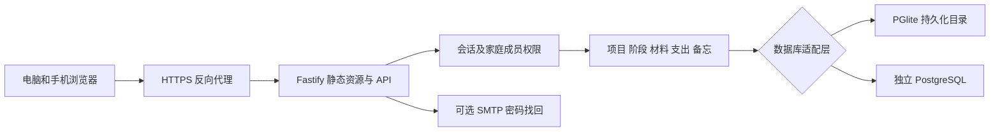

# 架构说明

版本：0.9.5。应用由 Vue 响应式前端、Fastify API 和可替换的 PostgreSQL 存储适配层组成。

## 前端

`src/main.ts` 定义路由，页面通过动态 import 加载；`App.vue` 处理电脑侧栏、手机导航、登录状态和当前家庭/项目。Pinia 的 `workspace` 保存界面上下文，Vue Query 管理业务请求、缓存和失效刷新。

家庭或项目切换后，旧查询缓存会清理，只有当前项目确实属于所选家庭时才请求业务数据。当前家庭、项目保存到服务器与本地偏好，链接使用 `family`、`project` 查询参数恢复上下文；URL 不授予访问权限。

金额、流程模板、角色和备忘导入规则放在 `shared/domain.ts`。图表使用 CSS/SVG 和文字明细；前端没有数据库凭据，不直接访问存储。

## 服务端

`server/app.ts` 负责字段校验、会话、角色、业务操作及错误映射，`server/index.ts` 负责数据库初始化、静态资源、端口和终止信号。`server/db.ts` 暴露 query、transaction、close 三个接口，两个数据库适配器共用 `schema.sql`。

内置适配器使用真实 PostgreSQL 引擎的 PGlite 并落盘，适合单进程。外置适配器使用 pg 连接池，数据库可以由 Compose、宿主机或云服务运行。两者不是直接可互换的数据文件格式，切换存储需要逻辑迁移。

生产静态文件支持 Brotli/Gzip 预压缩，带哈希的 assets 使用长期缓存，HTML 不长期缓存，API 使用 no-store。PWA 只缓存公共外壳和静态资源，排除账号、家庭和账本请求。

## 身份和权限

注册使用邮箱、密码与昵称，不验证邮箱。密码使用 Argon2id；服务端只保存随机会话令牌的哈希。Cookie 为 HttpOnly、SameSite=Lax，生产再启用 Secure；写请求检查 Origin 与应用请求头，认证接口限流。

每次访问先验证会话和家庭成员，再确认项目及关联资源属于相同家庭、相同项目。非成员拿到资源 ID 也无法查询。所有者、管理员、成员、只读成员的业务边界见用户指南。

写事务重新检查成员角色，并锁定相关家庭/项目。version 条件防止静默覆盖；支出 requestId 唯一键和内容指纹防止重试重复记账。材料移动阶段和关联支出更新在事务内完成。

## 金额和查询一致性

金额统一使用整数分，数据库字段为 bigint，界面输入按十进制转换。已记总成本等于有效已付加有效待付；材料计划不再次相加。数据库聚合覆盖全部记录，阶段、分类、材料等明细按关联维度汇总。

统计接口使用只读一致性快照，避免已付、待付和总成本来自不同时间。列表使用稳定排序与页码分页；分页期间新增记录可能改变后续页位置，未来可升级游标分页。

## 当前扩展边界

应用目前一个实例、进程内限流，前台刷新而非 WebSocket 推送。没有后台提醒队列、对象存储、账号注销或逐字段变更历史。schema 是初始建表脚本，后续结构变更需要正式版本化迁移。相关工作按路线图推进，不通过直接堆叠缓存或服务数量解决。
