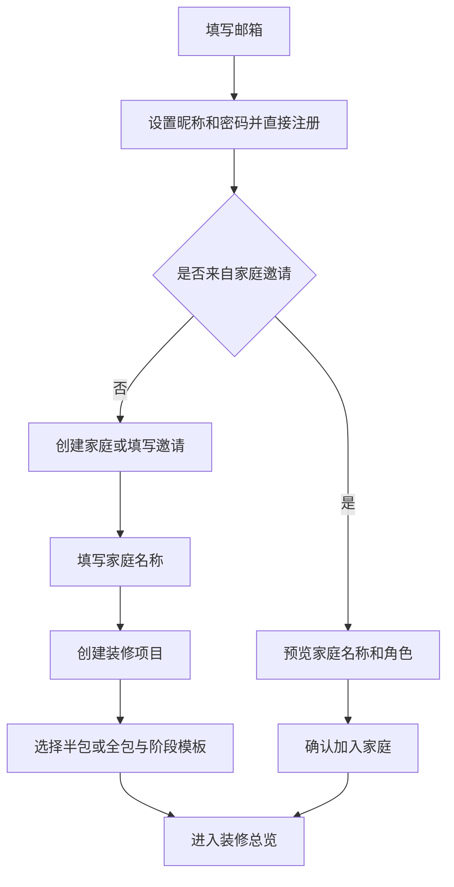
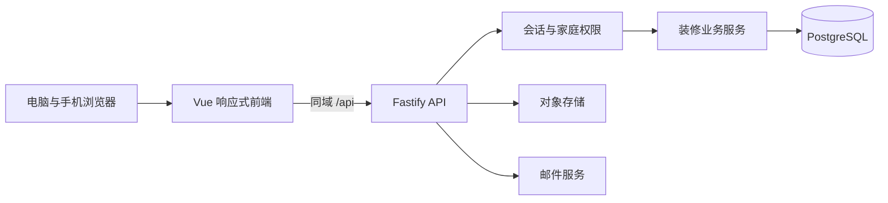
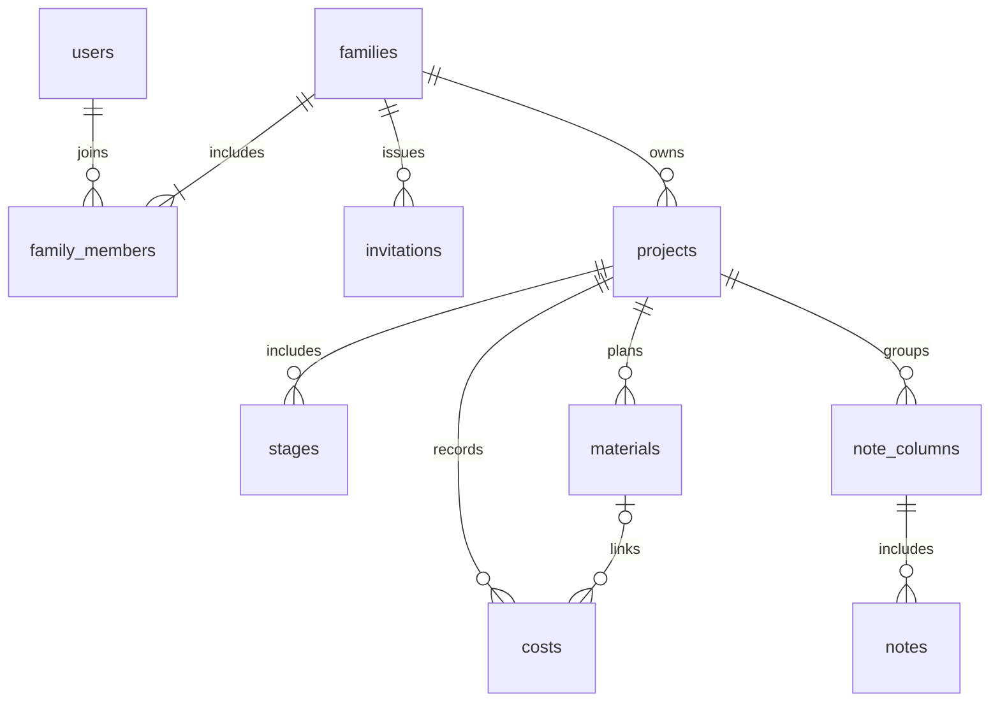

# 筑家手记 Web 产品与技术设计

设计日期：2026-10-29。状态：原始设计基线，首版实现范围与差异以 README 和 development.md 为准。

将现有个人装修工具升级为家庭共同使用的装修管理应用：一个人注册并创建家庭，邀请家人后，共同维护项目、材料、账本与备忘。电脑适合预算规划和批量整理，手机适合现场记账和查看待办，两端共享数据。

第一版采用响应式 Web，可添加到手机主屏幕；暂不开发独立 iOS/Android 原生应用。真实注册、权限隔离和跨设备同步由后端服务提供，不能仅靠浏览器本地存储实现。

## 1. 现有项目评估

已检查小程序页面、业务工具函数、七个云函数目录和数据库说明。当前有 13 个页面，使用原生小程序 TypeScript、WXML、WXSS，以及微信云开发数据库与存储。

| 现有能力                             | Web 处理方式                           |
| ------------------------------------ | -------------------------------------- |
| 微信身份登录、头像昵称               | 改成独立账号体系，头像改用标准文件上传 |
| 多项目、半包/全包、四种流程模板      | 保留；项目归属家庭                     |
| 阶段预算、排序、并行施工、聚焦阶段   | 保留；个人浏览偏好与共享进度分开       |
| 材料计划、型号、采购状态             | 保留；增加记录人、修改人               |
| 实际支出、材料关联、多次付款         | 保留；家庭成员共同记账                 |
| 账本筛选、草稿、复制上一笔、连续记录 | 保留；草稿按账号、家庭、项目隔离       |
| 项目/阶段/材料预算统计               | 保留计算规则，修正容易混淆的金额文案   |
| 备忘专栏、重点、确认状态、多行导入   | 完整保留                               |
| 软删除、撤销、写入幂等               | 保留，补充协作冲突控制                 |
| 微信隐私入口、原生反馈               | 替换成网页隐私说明、反馈入口           |

可复用的业务逻辑集中在 `miniprogram/utils/budget.js`、`material.js`、`notes.js` 与 `constants/project-templates.js`，以及相应单元测试。WXML 页面、微信路由和 `wx.*` 调用需要重写。云函数中的字段校验与业务规则可迁移，但身份获取和数据库访问不能直接照搬。

当前云函数以 `OPENID` 和 `ownerOpenid` 校验个人所有权。新增家庭表不足以实现共享，项目、列表、统计、关联资源、删除恢复等全部接口都需要改用家庭成员授权。

源码依据：`miniprogram/app.json`、`services/cloud.ts`、`cloudfunctions/*/index.js`、`database/README.md`、`docs/design-system.md`。原 README 部分段落仍写“六个云函数”，实际目录和数据库文档列出七个，设计按实际代码处理。

## 2. 第一版范围

第一版交付原有装修核心功能，并加入个人注册登录、创建/加入家庭、成员角色、家庭切换、共享数据与操作记录。首轮前端开发可以使用明确标注的演示数据，但正式验收必须连接真实 API。

暂缓：施工方独立账号、项目级自定义权限、聊天、AI 建议、自动推送、房间维度预算、票据 OCR、银行支付、原生 App 和离线写入同步。这里的“已支付”是用户记账状态，不是平台代收付。

历史数据迁移作为独立交付项：新系统可以先使用新数据运行；若需要带入旧数据，再执行经验证的导入流程，不自动连接或修改旧云环境。

## 3. 账号注册和家庭管理

### 3.1 注册与登录

按最新产品要求，注册填写邮箱、密码和昵称即可完成，不验证邮箱、不发送注册验证码。登录使用邮箱与密码，相同邮箱经大小写规范化后不可重复注册。忘记密码通过一次性邮件链接恢复，邮件服务仅为密码找回的可选依赖；生产未配置时明确显示该功能暂不可用。手机号登录与微信网页登录可后续独立接入。

密码使用 Argon2id 哈希；注册、登录和密码重置均做限流，密码最少 10 位。一次性重置链接短时有效，使用后失效。

登录使用服务端可撤销会话和 HttpOnly、Secure、SameSite Cookie。修改密码后撤销其他会话，退出登录撤销当前会话。写接口校验来源并防护 CSRF；前端路由隐藏不能替代服务端权限检查。

### 3.2 首次使用流程



已登录且已有家庭的用户可继续加入另一个家庭。一个账号可加入多个家庭，一个家庭可管理多个装修项目；第一版同一家庭内的全部项目共享同一套角色权限，没有隐藏的私人项目。

注册后可以稍后创建家庭；此时显示引导页，不自动创建无意义项目。家庭名字不要求全局唯一，邀请通过不可猜测的令牌识别家庭。

### 3.3 家庭角色

| 操作                                        | 家庭所有者 | 管理员 | 成员 | 只读成员 |
| ------------------------------------------- | ---------- | ------ | ---- | -------- |
| 查看项目、账本、材料、备忘                  | 是         | 是     | 是   | 是       |
| 新增、编辑、软删除/恢复共享材料、支出、备忘 | 是         | 是     | 是   | 否       |
| 更新施工阶段状态                            | 是         | 是     | 是   | 否       |
| 新建项目、预算设置、阶段结构调整            | 是         | 是     | 否   | 否       |
| 归档/恢复项目                               | 是         | 是     | 否   | 否       |
| 查看家庭操作记录                            | 是         | 是     | 是   | 是       |
| 邀请成员/只读成员，移除或调整这两类成员     | 是         | 是     | 否   | 否       |
| 任免管理员、修改家庭名称                    | 是         | 否     | 否   | 否       |
| 转让所有权、永久删除项目、解散家庭          | 是         | 否     | 否   | 否       |

成员默认可编辑其他成员的业务记录，符合家人共同记账场景；每次修改均记录操作者。管理员不能管理其他管理员、不能提升自己或修改所有者。所有者始终恰好一名，转让在事务内完成，原所有者转为管理员。

非所有者可主动退出家庭；所有者必须先转让或解散。移除成员立即使后续家庭 API 请求失去权限，但保留历史记录与操作者标识。账号注销时先处理其拥有的家庭，共享账目保留并匿名化个人资料，避免影响其他家人。

### 3.4 邀请机制

家庭管理页选择角色后生成单次使用邀请链接，有效期建议 48 小时，可以主动撤销；默认角色是成员，管理员邀请只能由所有者生成。接收人登录后看到家庭名称和权限，再明确确认加入。

令牌使用高熵随机值，服务端只存哈希，不进入分析日志；邀请页不展示账本或家庭成员隐私，设置不向第三方发送 referrer。首版为持链接者可申请接受的邀请，界面提示仅分享给预期家人。

接受时在同一事务中验证有效期、撤销状态、使用状态、邀请人当前授权和成员关系，锁定邀请并写入成员记录，避免并发超用。已加入的用户返回当前成员关系，不改变角色。邀请人失去对应邀请权限后，其未使用邀请失效。

## 4. 页面和信息架构

电脑使用左侧导航，手机使用底部导航：首页、账本、记一笔、备忘、我的。材料、阶段和统计从首页快捷入口进入，避免底部导航过多。“记一笔”点击进入表单，不作为内容列表。

| 页面               | 路由示例                                     | 核心内容                           |
| ------------------ | -------------------------------------------- | ---------------------------------- |
| 登录/注册/找回密码 | `/login`、`/register`、`/reset-password`     | 邮箱账号、密码、隐私说明           |
| 创建/加入家庭      | `/onboarding`                                | 家庭名、邀请入口                   |
| 邀请接受           | `/invite/:token`                             | 家庭与角色预览、确认加入           |
| 装修总览           | `/f/:familyId/p/:projectId/overview`         | 预算、已付/待付、阶段、近期记录    |
| 项目管理           | `/f/:familyId/projects`                      | 新建、切换、归档、恢复             |
| 阶段与详情         | `/f/:familyId/p/:projectId/stages/:stageId?` | 阶段进度、材料和费用               |
| 材料清单           | `/f/:familyId/p/:projectId/materials`        | 分类、采购状态、计划与实际         |
| 账本               | `/f/:familyId/p/:projectId/ledger`           | 组合筛选、金额汇总、记录人         |
| 记一笔             | `/f/:familyId/p/:projectId/costs/new`        | 支出表单，支持可选材料关联         |
| 装修备忘           | `/f/:familyId/p/:projectId/notes`            | 专栏、重点、待确认、粘贴导入       |
| 预算统计           | `/f/:familyId/p/:projectId/statistics`       | 阶段/分类对比、预算分配            |
| 家庭管理           | `/f/:familyId/settings`                      | 成员、邀请、角色、操作记录         |
| 我的               | `/me`                                        | 个人资料、家庭切换、账号安全、退出 |

路由包含家庭和项目，刷新及分享深链接时仍能恢复上下文，但持有 URL 不等于获得访问权。历史页返回、筛选条件和分页写入 URL；非法或已失效上下文回到家庭选择页。

### 4.1 首页低保真布局

电脑端：

```text
┌──────────┬──────────────────────────────────────────────────┐
│ 筑家手记 │ 林家的新家 ▾  /  新房装修 ▾             我的头像 │
│          ├──────────────────────────────────────────────────┤
│ 装修总览 │ 新房装修 · 半包                         [记一笔] │
│ 阶段计划 │ 总预算        已付金额       待付金额             │
│ 材料清单 │ 已记总成本    预算余额       预算使用进度         │
│ 装修账本 │───────────────────────────┬──────────────────────│
│ 装修备忘 │ 进行中的阶段              │ 待付款 / 待确认事项  │
│ 预算统计 │ 水电：预算 / 计划 / 成本  │ 查看对应记录         │
│          │───────────────────────────┴──────────────────────│
│ 家庭管理 │ 最近支出：事项、阶段、记录人、金额、支付状态     │
│ 我的账号 │ 家庭动态：谁更新了预算、材料或备忘               │
└──────────┴──────────────────────────────────────────────────┘
```

手机端：

```text
┌────────────────────────┐
│ 林家的新家 ▾  新房装修 ▾│
│ 新房装修 · 半包         │
│ 总预算       预算余额   │
│ 已付         待付       │
│ 已记总成本 / 预算进度   │
│ 阶段  材料  统计  家庭  │
│ 待付款提醒              │
│ 进行中的阶段 →          │
│ 最近支出                │
│ 家庭成员的最新修改      │
├────────────────────────┤
│ 首页 账本 记一笔 备忘 我│
└────────────────────────┘
```

### 4.2 关键交互

- 记一笔：默认当前项目和个人最近使用阶段，金额、名称为核心输入；分类和支付状态给出明确默认值，保持原待付默认规则。商家、支付方式、材料关联收在更多信息中。切换阶段不清空表单。
- 家庭管理：成员列表展示昵称和角色，按当前用户权限显示操作；待接受邀请单独列出。移除成员展示其立即失去访问权的后果。
- 材料清单：电脑表格适合对比计划、已付、待付、差额；手机变为卡片。材料变更阶段时提示会同步移动关联支出。
- 备忘：电脑左侧专栏、右侧事项；手机顶部专栏切换。状态、重点和记录人可见；批量粘贴先预览再提交。
- 删除：软删除后显示撤销入口，另有最近删除列表可恢复。已归档项目只读，恢复后才可修改；永久删除要求所有者再次验证身份并输入项目名。
- 协作：写入成功刷新相关查询；窗口重新聚焦、切换家庭时重新拉取；活动页面可每 30 秒刷新。第一版不依赖 WebSocket，不承诺即时同步。
- 编辑冲突：提交版本落后时显示“内容已被家人修改”，保留本地输入，允许查看最新内容后重新提交，不默默覆盖。
- 被移除或会话失效：停止刷新并清空该家庭前端缓存；退出账号清理本地草稿。已经被用户查看或下载的内容无法远程收回。

### 4.3 响应式与视觉

延续原项目暖色家居风：背景 `#F7F1E7`、卡片 `#FFFDF8`、品牌木棕 `#8B5E3C`、正文 `#332B25`、辅助鼠尾草绿 `#7F9275`、超支砖红 `#B45F4A`。状态同时用文字和图形表达；小字号文字和按钮对比度在实现时校验，不直接把浅绿用作小字颜色。

手机 `<768px` 单列、底部导航；平板 `768–1199px` 紧凑侧栏和双列；桌面 `≥1200px` 侧栏加宽内容区。内容最大宽度约 1440px。使用 CSS Grid/Flex 和 rem，不将 rpx 机械换成 px。

触控区域至少 44×44px，正文字号约 16px，输入支持数字键盘。适配安全区、软键盘、系统字体放大、键盘操作、焦点和读屏标签。每个列表提供加载、空数据、失败重试和无权限状态。

PWA 首版提供图标、manifest 和安装引导，仅缓存应用静态外壳；账本、家庭信息和认证 API 不进入 Service Worker 缓存。断网展示提示并允许保留草稿，不显示“云端保存成功”，暂不支持离线提交。不同浏览器的安装入口不同，不承诺原生 App 全部能力。

## 5. 金额与业务口径

所有金额保持整数分；输入按十进制字符串转换并验证上限，不依赖浮点乘法计算。数量可以是小数，单价乘数量按统一规则四舍五入到分；明确允许手工填写材料计划总价时，以总价为准。

现有统计把未删除支出的已付和待付全部计入实际成本，首页“已支出”易被理解成已支付。新页面改用以下名称，不改变原始金额含义：

| 指标         | 计算规则                                      |
| ------------ | --------------------------------------------- |
| 已付金额     | 有效支出中 `paymentStatus=paid` 的金额合计    |
| 待付金额     | 有效支出中 `paymentStatus=pending` 的金额合计 |
| 已记总成本   | 已付金额 + 待付金额                           |
| 预算余额     | 项目预算 − 已记总成本；负数显示超预算         |
| 材料计划     | 有效材料计划总价合计，不加到已记总成本        |
| 材料成本差额 | 计划金额 − 关联的有效已付/待付支出合计        |
| 未分配预算   | 项目预算 − 有效阶段预算合计                   |

例：预算 20 万，材料计划 6 万，已付 3 万，待付 2 万，则已记总成本 5 万、预算余额 15 万；不是成本 11 万。界面注明预算余额并不等于最终可自由支配资金，尚未记入的费用不在成本内。

一期沿用零预算表示“未设置预算”，不显示零作分母的百分比。不同支付节点分别记录独立支出；一期不扩展成付款流水系统。

删除材料不删除历史支出，也不使总成本减少；关联项显示“材料已删除”。恢复时重新进入材料计划统计。阶段有任何仍需引用的材料/支出时禁止删除；备忘项恢复要求所属专栏有效。

## 6. 技术方案

| 层次       | 推荐选型                                        | 原因                                   |
| ---------- | ----------------------------------------------- | -------------------------------------- |
| 前端       | Vue 3 + TypeScript + Vite                       | 适合表单、列表和渐进迁移；独立静态构建 |
| 路由与数据 | Vue Router + TanStack Vue Query                 | 深链接、API 缓存和失效管理             |
| 本地状态   | Pinia                                           | 用户界面状态；不重复保存服务端业务数据 |
| UI         | 自有设计变量与组件，基于 Reka UI 无样式交互组件 | 保留暖色风格与键盘可访问性             |
| 校验与图表 | Zod + ECharts 按需加载                          | 前后端契约与预算对比                   |
| API        | Node.js 当前受支持 LTS + Fastify + TypeScript   | 与前端共享类型，清晰分离服务权限       |
| 数据库     | PostgreSQL + Prisma                             | 家庭关系、事务、约束和迁移             |
| 文件       | S3 兼容对象存储，按部署环境选择供应商           | 头像等文件独立管理                     |
| 测试       | Vitest + API 集成测试 + Playwright              | 金额口径、权限和双端关键流程           |

本方案推荐独立 API，便于脱离微信运行。另一条路线是保留 CloudBase 数据库并新增 Web 身份接入，短期数据迁移较少，但仍要重写鉴权，并验证网页访问、身份映射与部署能力；不能仅替换 `wx.cloud.callFunction` 就完成迁移。



生产使用 HTTPS，同域反向代理静态页面与 `/api`，避免复杂跨域会话。SPA 路由由服务器回退到 index.html，API 路由不能回退 HTML。密钥只放服务端环境变量，建立数据库备份和恢复验证。具体云厂商、域名与邮件供应商在部署时选择。

建议目录（以下尚未创建）：

```text
renovation_assistant_web/
  apps/
    web/src/
      app/                 路由、布局、初始化
      features/            auth、families、projects、costs 等
      components/          表单、卡片、金额、状态、弹窗
      services/            HTTP 客户端与查询封装
      styles/              设计变量与响应式规则
    api/src/
      modules/             auth、families、装修业务
      plugins/             会话、权限、错误处理
  packages/domain/         金额、模板、校验与共享类型
  prisma/                  模型、迁移、开发种子数据
  tests/e2e/               双端流程与协作验收
  docs/                    设计、部署、迁移说明
```

## 7. 数据模型与权限约束



| 表                   | 主要字段与约束                                                                                                                 |
| -------------------- | ------------------------------------------------------------------------------------------------------------------------------ |
| users                | id、规范化 email 唯一、emailVerifiedAt、passwordHash、nickname、avatarKey、status                                              |
| sessions             | tokenHash 唯一、userId、expiresAt、revokedAt                                                                                   |
| verification_tokens  | purpose、subject、tokenHash、expiresAt、consumedAt、attempts                                                                   |
| families             | id、name、ownerUserId、status、createdAt；所有者必须是有效家庭成员                                                             |
| family_members       | familyId、userId、role、status、joinedAt；familyId+userId 唯一                                                                 |
| invitations          | familyId、tokenHash 唯一、role、invitedBy、expiresAt、usedBy、usedAt、revokedAt                                                |
| projects             | familyId、name、address、packageType、budgetCents、工期、status、templateId                                                    |
| stages               | familyId、projectId、name、order、budgetCents、status                                                                          |
| materials            | familyId、projectId、stageId、名称/分类/数量/单位/型号、计划金额、采购状态                                                     |
| costs                | familyId、projectId、stageId 可空、materialId 可空、amountCents、paymentStatus、merchant、paymentMethod、incurredAt、requestId |
| note_columns / notes | familyId、projectId、专栏顺序 / columnId、title、details、starred、status                                                      |
| user_preferences     | userId、familyId、currentProjectId；阶段偏好按 userId+projectId 保存                                                           |
| audit_logs           | familyId、actorUserId、entityType、entityId、action、变更字段、createdAt                                                       |

业务记录统一有 createdBy、updatedBy、createdAt、updatedAt、version 和可空 deletedAt。服务端从会话写入操作者，不接受客户端伪造。审计不记录密码、会话、邀请令牌；历史修改展示业务字段，限制审计本身的访问范围。

关键约束：

1. 每次请求先验证会话，再验证家庭有效成员及角色，再验证资源属于该家庭。非成员访问返回不暴露资源存在性的 404；已是成员但操作权限不足返回 403。
2. 列表、统计、搜索、恢复、批量导入与文件签名 URL 均执行同样校验。关联材料、阶段和备忘专栏必须属于同一家庭、同一项目。
3. 业务表建立 `(id, familyId, projectId)` 等组合唯一键和相应复合外键，防止跨家庭、跨项目关联。createdBy 只表示记录来源，不能作为共享访问过滤条件。
4. 支出创建唯一键采用 `(familyId, projectId, createdBy, requestId)`，同键同内容返回原结果，不同内容返回 409。重新发送必须复用原 requestId。
5. 更新使用 `id + version` 条件并递增版本；冲突返回 409。材料和关联支出的阶段移动、阶段排序、所有权转让、邀请接受在事务中完成。关联支出同步更新版本和审计。
6. 归档项目只读；删除/解散首先标记进入不可写状态，后台按明确范围清理，避免与写入竞争。销毁策略和备份保留期上线前写入隐私说明。
7. 当前家庭/项目/聚焦阶段属于个人偏好，不能让一个家人的浏览切换另一个人的首页；施工状态和预算仍然共享。
8. 列表默认分页，不靠一次拉取所有数据算总账；数据库聚合覆盖全部匹配记录。日期按业务日期保存，审计时间保存 UTC，界面按用户时区展示，避免日期偏移。

## 8. API 设计边界

REST 前缀 `/api/v1`。接口以下列资源划分，具体 OpenAPI 契约在实施阶段固化。

| 模块     | 接口示例                                                                                                      |
| -------- | ------------------------------------------------------------------------------------------------------------- |
| 账号     | `POST /auth/register`、`POST /auth/login`、`POST /auth/logout`、密码重置、`GET /me`                           |
| 家庭     | `GET/POST /families`、`GET/PATCH /families/:fid`                                                              |
| 成员     | `GET /families/:fid/members`、`PATCH/DELETE /families/:fid/members/:uid`、`POST /families/:fid/leave`         |
| 邀请     | `POST /families/:fid/invitations`、撤销、`GET /invitations/:token/preview`、`POST /invitations/:token/accept` |
| 所有权   | `POST /families/:fid/transfer-ownership`                                                                      |
| 项目     | `/families/:fid/projects`，项目详情、归档、恢复、销毁                                                         |
| 装修资源 | `/families/:fid/projects/:pid/stages`、`materials`、`costs`、`note-columns`、`notes`                          |
| 汇总     | `GET /families/:fid/projects/:pid/statistics`                                                                 |
| 操作记录 | `GET /families/:fid/audit-logs`                                                                               |

响应统一为 `{ data, meta? }`；错误为 `{ error: { code, message, fields? }, traceId }`。区分 401 登录失效、403 操作受限、404 资源不可访问、409 幂等/版本冲突、422 字段错误、429 频率限制。列表返回分页游标，稳定按业务日期和 ID 排序；筛选汇总与列表使用同一条件。

客户端只自动重试可安全重试的读取；写操作失败保留草稿并允许携原幂等键重试。文件上传检查类型、大小及所有权，私有文件用短时授权访问；不把内部堆栈或存储凭据返回前端。

## 9. 旧数据迁移

旧账号只有微信 openid，不能通过同名昵称或用户输入的 openid 直接认领。必须由旧小程序中的已认证用户生成短期一次性迁移凭证，再由新账号登录后兑换，或采用经核实的人工管理迁移流程。未完成身份核实时不开放自助认领。

迁移步骤：

1. 经授权导出云数据库和文件清单，建立备份；先在隔离环境演练。
2. 为每个旧用户创建映射到新账号的默认家庭；只按已验证的身份关系归并，多人的旧项目不会因昵称相同自动合并。
3. 保存 legacyId 与映射表，依次迁移项目、阶段、材料、支出、备忘；将 ownerOpenid 替换为 familyId 与 createdBy。
4. 保留整数分、软删除、归档、排序、付款状态与历史时间；兼容旧备注中的“型号：”字段。云文件 ID 转成新文件引用，不直接作为公共 URL。
5. 比较项目数量、有效/已删除记录数量、已付/待付/总成本、阶段预算、材料计划与备忘数量；检查所有关联和无阶段支出。
6. 正式切换时设置旧系统短时只读或安排最终增量导入，验证通过后再开放新系统写入。首版不做双向同步。

导入使用稳定映射和唯一约束实现可重复执行；失败按导入批次回滚。新系统开始产生数据后，回退必须先保全新记录并处理增量，不能简单覆盖数据库。

## 10. 实施顺序与验收

| 阶段             | 交付内容                                         | 完成标准                                              |
| ---------------- | ------------------------------------------------ | ----------------------------------------------------- |
| 1 页面与工程基础 | 设计变量、响应式布局、路由、示例首页/账本/家庭页 | 390px 和 1440px 两种宽度可用；演示数据有明显标识      |
| 2 注册与家庭闭环 | 数据库、会话、直接注册、邀请、角色               | 两个账号加入同一家庭；第三个家庭账号无法读写其数据    |
| 3 装修功能迁移   | 项目、模板、阶段、材料、记账、备忘               | 原有核心能力保留；跨端刷新可见修改                    |
| 4 统计与协作完善 | 金额聚合、版本冲突、审计、撤销、权限变化         | 已付/待付口径正确，重复提交仅一条，两人编辑不静默覆盖 |
| 5 发布准备       | PWA、部署、备份、真机测试，按需要迁移旧数据      | HTTPS 可访问、深链接刷新正常、数据隔离测试通过        |

重点验收用例：

- 所有者在电脑创建家庭和项目，家人在手机注册并接受邀请，新增支出后双方看到相同统计。
- 只读成员即使直接请求写 API 也被拒绝；普通成员不能修改预算和管理成员。
- 过期、已撤销、已用邀请均无法再次加入；并发接受只成功一次；重复成员不被重复创建。
- 所有者不能直接退出；转让后始终只有一位所有者；管理员不能提升自身权限。
- 成员被移除后，其已有会话也不能继续访问家庭数据，历史支出仍保留。
- 材料计划 6000 元、已付 1000 元、待付 2000 元时，总成本为 3000 元；软删除和恢复后统计正确。
- 一个材料的定金与尾款分别记账；材料移动阶段后所有关联支出同步移动；无阶段支出仍进入总账。
- 双击提交、超时后重试不会产生重复支出；多人修改同一记录显示冲突。
- 多页账本统计与数据库全集一致，包含待付、无阶段记录，排除软删除；用户切换家庭后草稿与缓存不会混用。
- 测试 iOS Safari、Android Chrome、微信内置浏览器和桌面主流浏览器；覆盖 360px/390px/768px/1440px、长名称、大金额、软键盘和弱网。

## 11. 本方案的默认决定

以下为设计阶段的默认选择。首版应用已经开始实施，技术落地与当前验证范围见 README 和 development.md；历史云端数据尚未迁移。

- 手机端采用浏览器与 PWA，不单独维护原生 App。
- 注册采用邮箱与密码，不做邮箱验证；手机号登录可后续独立接入。
- 家庭内项目默认全部共享，普通成员能协作编辑账目，预算与结构调整限管理员以上。
- Vue 3 前端与独立 API 同仓维护，PostgreSQL 存储，旧小程序保持独立。
- 不自动迁移现有线上数据；历史数据迁移须先建立身份映射并核对金额。
