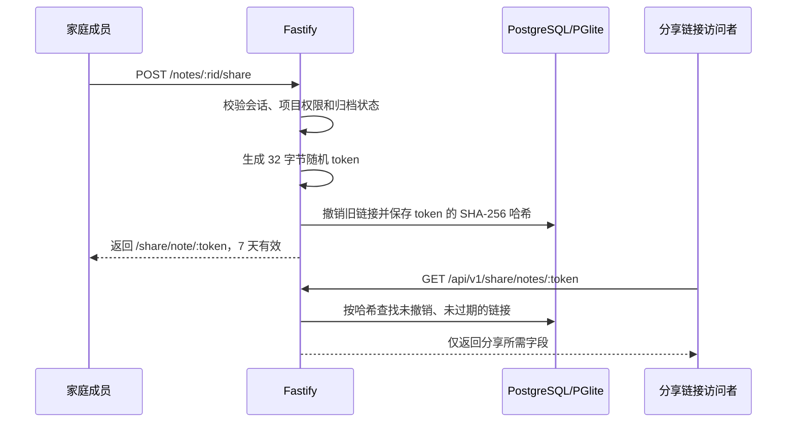

# 备忘分享与公开访问

适用版本：0.9.17。本文说明只读分享的接口、公开路由和安全边界。

## 访问链路

## 链接生命周期

- 创建：可写成员调用 `POST /families/:fid/projects/:pid/notes/:rid/share`。
- 查看：访问 `/share/note/:token`，前端请求公开只读 API。
- 过期：默认创建后 7 天。
- 撤销：查看弹窗中停止分享，或重新生成链接，所有旧链接立即失效。
- 删除：备忘被软删除后，即使令牌未过期也返回 404。

`note_shares` 保存令牌哈希、创建者、有效期和撤销时间；数据库没有可直接使用的明文令牌。重新生成采用先撤销旧链接、再插入新链接的事务。

## 公开路由

`src/router/public-paths.ts` 是唯一的路径分类来源：

- 认证页：`/login`、`/register`、`/reset-password`。
- 公开分享页：`/share/note/*`。
- 其他业务页仍需要登录。

应用等待 `router.isReady()` 后才挂载，避免首次加载时把分享地址误判为 `/`。只有认证页会把已登录用户送回首页，分享页在登录前后均保持可见。

新增公开页面前必须先明确它为什么无需登录，以及它读取哪些数据，不能只为了绕过登录跳转而扩大公开路径。

## 返回字段

公开接口只返回标题、描述数组、重点和确认状态、专栏名称、记录人昵称与创建/更新时间。不返回家庭 ID、项目 ID、账号 ID、会话、成员列表或其他业务记录。

## 安全边界

分享链接是 Bearer 链接：**任何持有完整链接的人都可以查看内容**，系统无法区分预期接收者和转发者。它不提供访问密码、访问次数限制、按访问者授权或下载水印。

因此：

1. 只分享允许被接收者查看的内容，不把分享链接写入公开文档或日志。
2. 生产入口应使用 HTTPS，避免令牌在传输中暴露。
3. 停止分享只影响后续访问，不能收回他人已经看见、复制或截图的内容。
4. 浏览器不缓存 `/api/` 响应；公开链接的外链使用 `target="_blank"` 和 `rel="noopener noreferrer"`。
5. 后端统一设置 `Referrer-Policy: no-referrer`，降低跳转到第三方网址时泄露令牌的风险。

当前不统计访问者身份或访问日志；如需合规审计，应另行设计最小化记录与保留期限。

## 验收清单

- 未登录浏览器打开链接能看到完整只读内容。
- 已登录浏览器打开链接仍停留在分享页。
- 过期、撤销、重新生成和备忘删除后均返回 404。
- 只读成员不能创建分享链接。
- 描述中的网址能打开且中文标点不被吞入 URL。
- 反向代理必须同时转发分享页面和 `/api/v1/share/notes/*`，生产入口支持 SPA 深链接回退。
